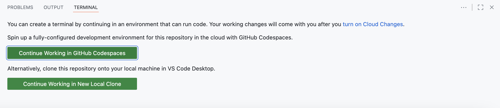

# Introduction to feature management with Unleash.io

Welcome to this lab exercise where we will explore feature management using Unleash.

## Overview

In this lab you will use a feature toggle to switch a Lambda between two sentiment-analysis backends: AWS Comprehend and Amazon Bedrock. Skim the service descriptions below before starting.

### AWS Comprehend

Amazon Comprehend is a managed natural language processing (NLP) service. It exposes task-specific APIs for things like sentiment analysis, entity recognition, key-phrase extraction, and language detection.

Its sentiment analysis endpoint takes a piece of text and returns one of four labels — `POSITIVE`, `NEGATIVE`, `NEUTRAL`, or `MIXED` — along with a confidence score for each label. The model is fixed; there is no prompt and no choice of underlying model.

### Amazon Bedrock

Amazon Bedrock is a managed service for calling large language models (LLMs) through a single API. It gives access to models from several providers — including Anthropic Claude, Meta Llama, Mistral, and Amazon Nova — without having to host them yourself.

Unlike Comprehend, Bedrock does not expose task-specific endpoints. You send a prompt describing what you want and the model generates a free-form response. In this lab we ask Claude to classify sentiment and to include a short `reasoning` field explaining why — the kind of open-ended output a general-purpose LLM makes easy and that a fixed-task API like Comprehend cannot produce.

### AWS Lambda

AWS Lambda runs your code in response to events (HTTP requests, queue messages, scheduled triggers, etc.) without you provisioning or managing servers. The runtime scales up and down automatically and you are billed only for the compute time your code actually uses. In this lab the function is invoked through API Gateway when a client makes a POST request.

### AWS SAM

The AWS Serverless Application Model is an extension of CloudFormation with a shorter syntax for defining serverless resources such as Lambda functions and API Gateway endpoints. It ships with a CLI that can build the deployment package, invoke the function locally in a container that matches the real Lambda runtime, and deploy to AWS.

### Unleash.io

Unleash is an open-source feature-flag platform. Flags are defined in the Unleash UI and evaluated by an SDK inside the running application, so flipping a flag changes behaviour without a redeploy. Unleash supports several strategies, including environment-based toggles, user-targeted rollouts, and gradual (percentage) rollouts, which makes it useful for continuous delivery and A/B testing.

## Lab intro

In this lab you will:

* Use the Unleash UI to create a feature toggle.
* Utilize GitHub Codespaces, a cloud-based development environment, to build and run an AWS Lambda function.
* Observe how we can switch the toggle on or off and see the resulting responses.
* Test a gradual rollout strategy and observe that the toggle state is randomized with a given probability of being on or off.
* If the feature toggle is enabled, pass the request body to AWS Comprehend.
* If the feature toggle is disabled, return a mock result of positive, with no confidence score.
* Deploy the Lambda function and test the API endpoint.

Observe the effects of setting the toggle on or off by viewing the results in your browser.

## Create a toggle in unleash.io

The unleash instance is running at
https://eu.app.unleash-hosted.com/eubb1043/

* Log into Unleash with the credentials given in class.
* You might also have been given an invite code.
* Please remind your instructor that your user will need "Editor" or "Admin" access. He frequently forgets to do this!

When in the Unleash UI:

* Click on the "Default" project.
* Click on the "New Feature Flag" button.
* Enter a name for the feature toggle, including your name to avoid naming conflicts (e.g. `glenn_toggle`).
* Choose the "Release" toggle type.
* Leave the remaining values as their defaults.
* Click on the "Create Feature Flag" button.
* On the main feature flag page, enable the flag for the "Development" environment.


## Set up your GitHub Codespace

* Fork this repository to your own GitHub account by clicking the "Fork" button in the top right corner of the GitHub page
* Once forked, navigate to your forked repository
* Click the green "Code" button and select the "Codespaces" tab
* Click "Create codespace on main" to launch your development environment

* Wait for the Codespace to initialize - this may take a minute or two
* Once ready, you'll have a fully configured VS Code environment in your browser
* Familiarize yourself with Codespaces by exploring the interface - it works just like VS Code!


## Terminal

* You will need to create a terminal in your Codespace. When asked, choose "Continue working in Codespaces".

The terminal is available at the bottom of the screen in your Codespace (if you don't see it, go to `Terminal > New Terminal` from the menu).

When you enable the terminal, GitHub Codespaces might have to do more initialization. Grab a coffee!



## Add an Unleash token to your template.yaml file

On the left side in the Codespace, there is a file browser (Explorer) where you can see all the files in the repository.

Add an Unleash token to the code.

The token will be given in class, and should be added to this segment of the template.yaml file:

````text
    Properties:
      CodeUri: sentiment_demo/
      Handler: app.lambda_handler
      Runtime: python3.12
      Environment:
        Variables:
          UNLEASH_API_TOKEN: "TOKEN"
      Architectures:
````

Also, in the `sentiment_demo` folder, there is a file `app.py`. You need to change the following line to use your own feature toggle:

```shell
    if client.is_enabled('glenn_toggle'):
```

## Configure AWS Credentials

Before you can build and run the Lambda function, you need to configure your AWS credentials. These will be provided to you in the classroom.

Open the terminal in your Codespace and run:

```shell
aws configure
```

You will be prompted to enter the following information:

```
AWS Access Key ID [None]: <enter the access key provided in class>
AWS Secret Access Key [None]: <enter the secret key provided in class>
Default region name [None]: eu-west-1
Default output format [None]: json
```

This configuration is necessary for:
* Running the Lambda function locally with AWS Comprehend
* Deploying the Lambda function to AWS

You can verify your configuration by running:

```shell
aws sts get-caller-identity
```

## Build and run the Lambda function locally

Important! Before going forward, make sure you understand the logic of the Lambda function. It uses the toggle to decide whether to:

* Return a mock response for the sentiment analysis
* Call the AWS Comprehend service to do a proper sentiment analysis

Open the terminal in your Codespace and run:

```shell
sam build --use-container
sam local invoke -e event.json
```

The event.json file looks very comprehensive! But it's actually just how an HTTP request is passed from the API client to the Lambda function through the AWS service called API Gateway. Find the "body" element in the file to try out different text inputs.

The response might look something like this:
```text
END RequestId: 5e84abaf-fc32-4d50-86f8-4219764c8d5e
REPORT RequestId: 5e84abaf-fc32-4d50-86f8-4219764c8d5e  Init Duration: 0.14 ms  Duration: 1151.45 ms    Billed Duration: 1152 ms        Memory Size: 512 MB     Max Memory Used: 512 MB
{"statusCode": 200, "headers": {"Content-Type": "application/json"}, "body": "{\"sentiment\": \"positive\", \"confidence\": 0.9991305470466614}"}
```

*What exactly am I looking at?* The JSON you see here is the result of the AWS Comprehend service's sentiment analysis on the text given in the HTTP request body. Is it positive? Is it negative, or neutral?

Play around with it; change the body. How positive can you get? Puppies and cake?

Try toggling your feature on and off. When the toggle is off, the Lambda should return positive sentiment, but with no confidence.
When enabled, it should return 200 OK.

Depending on what you want to focus on — AWS deployment of your function, feature toggles, and so on — please feel free to pick any of the bonus challenges.

## Bonus: Deploy the Lambda to AWS

```shell
sam deploy --guided
```

Please note that you do not need to provide the "guided" flag after the first deployment has been done. During the
deployment process, provide the following input, but use your *own name* in the stack name.

```
Setting default arguments for 'sam deploy'
=========================================
Stack Name [sam-app]: your name or something
AWS Region [eu-west-1]:
#Shows you resources changes to be deployed and require a 'Y' to initiate deploy
Confirm changes before deploy [y/N]: N
#SAM needs permission to be able to create roles to connect to the resources in your template
Allow SAM CLI IAM role creation [Y/n]: Y
#Preserves the state of previously provisioned resources when an operation fails
Disable rollback [y/N]: N
HelloWorldFunction may not have authorization defined, Is this okay? [y/N]: Y
Save arguments to configuration file [Y/n]: Y
SAM configuration file [samconfig.toml]:
SAM configuration environment [default]:
```

This will take some time, and when it is done, the endpoint given to your Lambda will be displayed — something like
this (just an example):

```shell
Key                 HelloWorldApi                                                                                                                                                                                                         
Description         API Gateway endpoint URL for Prod stage for Hello World function                                                                                                                                                      
Value               https://6ztkdjfii8.execute-api.eu-west-1.amazonaws.com/Prod/hello/    
```

The Lambda function is deployed with the domain name / URL given by *Value* in your output.

If you have Postman installed, or another API client, the URL should be similar to this: `https://26gfk7hsl6.execute-api.eu-west-1.amazonaws.com/Prod/sentiment`.

**Warning!** Please note that the URL should contain `/Prod/sentiment`. Sometimes SAM outputs `/Prod/Hello` instead.
The method is POST, and the body should be raw text.

You can test the API with `curl` from the terminal in your Codespace:

```bash
URL=<url from output of SAM deploy>
curl -X POST $URL  -H "Content-Type: application/json" -d 'Sharknado is an absolute disaster, and not in the fun, campy way you might expect. The plot is absurd, and not in a clever or entertaining way, The CGI is laughably bad, with the sharks looking more like floating clip art than any real threat.' | jq
```

## Bonus: Set a Randomized 50% rollout strategy for the toggle

* Go to the Unleash UI and find your toggle.
* Find the Development environment and click the "strategy" button.
* Change to Randomized stickiness and 50%.
* Observe that the toggle will evaluate to true in about 50% of the Lambda invocations.
  


# More bonus challenges:

* Try different settings for the toggle (percentage, sticky randomness, etc.).
* Look at the documentation for the Comprehend client: https://boto3.amazonaws.com/v1/documentation/api/latest/reference/services/comprehend.html
* Can you add more functionality? How about `detect_dominant_language`, keyword extraction, or toxic-language or entity detection?
* Explore Unleash and see if you can create a gradual rollout strategy for your toggle!
* Explore the Python SDK for Unleash: https://docs.getunleash.io/reference/sdks/python
